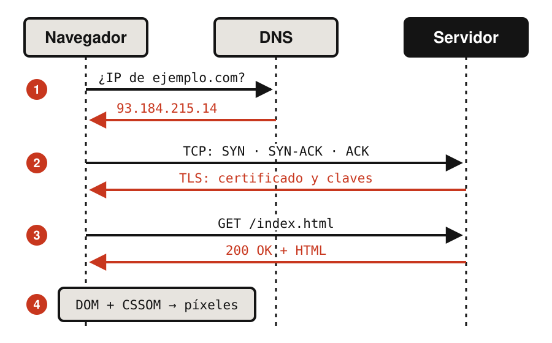

Escribir `ejemplo.com` en la barra de direcciones parece instantáneo, pero detrás hay una pequeña cadena de pasos que se repite cada vez que abrimos una página. Entenderla ayuda a saber por qué una web tarda en cargar y qué podemos hacer como desarrolladores para que vaya más rápido.

## 1. Traducir el nombre: DNS

Los ordenadores no se localizan por nombres, sino por **direcciones IP** (por ejemplo `93.184.215.14`). El primer trabajo del navegador es preguntar al **DNS** (*Domain Name System*) qué IP corresponde al dominio. Antes de salir a la red mira en varias cachés (la del propio navegador, la del sistema operativo, la del router), y solo si no encuentra la respuesta consulta a un servidor DNS, que a su vez puede preguntar a los servidores raíz, a los del dominio de primer nivel (`.com`) y por último a los autoritativos del dominio.

## 2. Abrir la conexión: TCP y TLS

Con la IP en la mano, el navegador abre una conexión **TCP** con el servidor, normalmente al puerto 443. TCP garantiza que los datos lleguen completos y en orden gracias a un saludo inicial en tres pasos (*SYN*, *SYN-ACK*, *ACK*). Encima de esa conexión se negocia **TLS**, que cifra todo lo que viaja y permite comprobar con un certificado que el servidor es quien dice ser. Ese es el candado que vemos junto a la URL cuando la dirección empieza por `https://`.



## 3. Pedir y recibir: HTTP

Ya podemos hablar **HTTP**. El navegador envía una petición con un método, una ruta y unas cabeceras:

```http
GET /index.html HTTP/1.1
Host: ejemplo.com
Accept: text/html
```

Y el servidor contesta con un **código de estado**, sus propias cabeceras y el cuerpo, que en este caso es el HTML de la página:

```http
HTTP/1.1 200 OK
Content-Type: text/html; charset=utf-8
Cache-Control: max-age=3600
```

Los códigos más habituales son `200` (todo bien), `301` (la página se ha movido), `404` (no existe) y `500` (error en el servidor). Al leer el HTML, el navegador descubre que necesita más archivos (hojas de estilo, scripts, imágenes) y lanza una petición por cada uno.

## 4. Dibujar: del HTML a los píxeles

Con los archivos llegando, el navegador construye dos árboles: el **DOM**, a partir del HTML, y el **CSSOM**, a partir del CSS. Los combina en un árbol de renderizado, calcula el tamaño y la posición de cada caja (*layout*) y finalmente pinta los píxeles en pantalla (*paint*). Si un script modifica el DOM, parte de este trabajo se repite.

## Qué me llevo

- Cada archivo extra es una petición más: menos archivos y más ligeros significa una web más rápida.
- Las cabeceras de caché (`Cache-Control`) evitan descargar otra vez lo que no ha cambiado.
- HTTPS no es opcional: protege al usuario y hoy los navegadores marcan como inseguras las páginas que no lo usan.

Este mismo blog es un buen ejemplo: como son páginas estáticas, el servidor solo tiene que entregar archivos ya hechos, sin calcular nada en cada visita. De eso hablo en la entrada sobre [generadores de sitios estáticos](este-blog-no-necesita-servidor.html).
