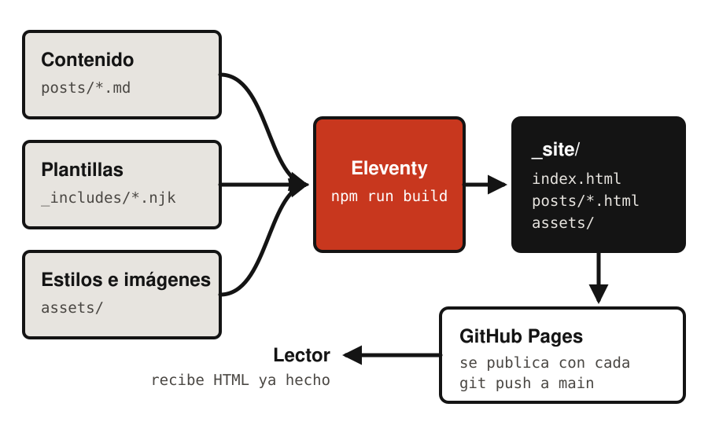

Un blog como WordPress es una **aplicación dinámica**: cada vez que alguien visita una entrada, el servidor ejecuta código PHP, consulta una base de datos y monta el HTML en ese momento. Funciona, pero hace falta un servidor encendido, mantenerlo actualizado y protegerlo.

Un **generador de sitios estáticos** (*static site generator*, SSG) hace ese trabajo **una sola vez, antes de publicar**. El resultado es una carpeta de archivos HTML, CSS e imágenes ya terminados que cualquier servidor puede entregar sin pensar.

## Las tres piezas

1. **Contenido** en archivos de texto, normalmente Markdown, con unos metadatos al principio (el *front matter*).
2. **Plantillas** que definen el diseño común: cabecera, menú, pie de página.
3. **El generador**, que junta cada archivo de contenido con su plantilla y escribe el HTML final.



## Cómo es una entrada de este blog

Cada entrada es un archivo `.md` en la carpeta `src/posts`. Lo que va entre las dos líneas `---` son los metadatos:

```markdown
---
title: "Flexbox y Grid: dos formas de colocar cajas"
date: 2026-11-11
tags: [CSS, Maquetación]
portada: portada-css.svg
---

Durante años, colocar elementos en una página con CSS...
```

La plantilla de entrada usa esos datos con la sintaxis de Nunjucks:


```html
<h1>{{ title }}</h1>
<time datetime="{{ page.date | iso }}">{{ page.date | fecha }}</time>
<div class="cuerpo">{{ content | safe }}</div>
```


Al ejecutar `npx @11ty/eleventy`, el generador recorre todos los archivos, crea la portada con la lista de entradas, el archivo por fechas y una página por etiqueta, y lo deja todo en la carpeta `_site`.

## ¿Por qué Eleventy?

La actividad proponía Gatsby o Jekyll. Los comparé con Eleventy antes de decidir:

| Generador | Lenguaje | Lo que me convenció o no |
| --- | --- | --- |
| Jekyll | Ruby | Integrado en GitHub Pages, pero requiere instalar Ruby y sus gemas. |
| Gatsby | JavaScript + React | Muy potente, aunque para un blog de texto es mucha maquinaria. |
| Hugo | Go | Rapidísimo; su sistema de plantillas me pareció más difícil de aprender. |
| **Eleventy** | JavaScript | Solo necesita Node.js, no impone ningún framework y el HTML que genera es limpio. |

Con Eleventy el HTML y el CSS son exactamente los que yo escribo, que era el objetivo de la práctica.

## Publicar con GitHub Pages

El código vive en un repositorio de GitHub. Una **GitHub Action** se ejecuta cada vez que subo un cambio a la rama `main`: instala las dependencias, ejecuta Eleventy y publica la carpeta `_site` en GitHub Pages. Publicar una entrada nueva es tan simple como crear un archivo Markdown y hacer `git push`.

## Ventajas y límites

**A favor:** carga muy rápida porque no hay nada que calcular; seguridad, ya que no hay base de datos ni código en el servidor que atacar; hosting gratuito; y todo el contenido está en archivos de texto con control de versiones.

**En contra:** no hay panel de administración para escribir desde el navegador, y lo que sea interactivo de verdad (comentarios, formularios, usuarios) necesita servicios externos o un poco de JavaScript.

Para un blog personal, el balance me parece claramente a favor de lo estático. Si quieres ver el recorrido desde el otro lado, el del navegador que pide estas páginas, está en la primera entrada: [De la URL a la pantalla](de-la-url-a-la-pantalla.html).
