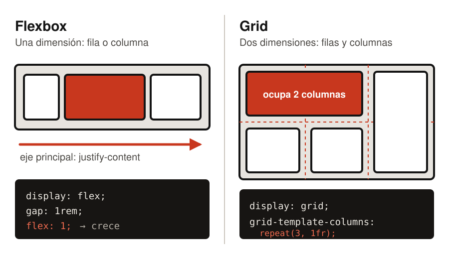

Durante años, colocar elementos en una página con CSS fue una pelea con `float`, márgenes negativos y trucos para limpiar flotados. Hoy tenemos dos sistemas diseñados específicamente para maquetar: **Flexbox** y **CSS Grid**. No compiten entre sí; cada uno resuelve un tipo de problema.

## Flexbox: una dimensión

Flexbox organiza los hijos de un contenedor **a lo largo de un eje**, ya sea en fila o en columna. Es ideal para menús, barras de herramientas, una fila de botones o centrar algo.

```css
.menu {
  display: flex;
  gap: 1rem;                 /* espacio entre elementos */
  justify-content: space-between; /* reparto en el eje principal */
  align-items: center;       /* alineación en el eje cruzado */
  flex-wrap: wrap;           /* saltan de línea si no caben */
}
```

Las dos propiedades que más uso son `justify-content`, que reparte el espacio en el eje principal, y `align-items`, que alinea en el perpendicular. Con `flex: 1` en un hijo, ese elemento crece para ocupar el espacio que sobra.

## Grid: dos dimensiones

Grid define **filas y columnas a la vez**, y luego coloca los elementos en esa cuadrícula. Es la herramienta adecuada para la estructura general de una página o para una galería de tarjetas.

```css
.rejilla {
  display: grid;
  grid-template-columns: repeat(auto-fill, minmax(280px, 1fr));
  gap: 1.5rem;
}
```

Esa línea de `grid-template-columns` es de las más útiles de CSS: crea tantas columnas de al menos 280 px como quepan y reparte el sobrante entre ellas. En un móvil sale una columna, en un portátil tres, y no hace falta ninguna *media query*.



## ¿Cuál elijo?

Una regla sencilla que me funciona:

- Si pienso en **una fila o una columna** de cosas y quiero que el contenido decida el tamaño, uso **Flexbox**.
- Si pienso en **una cuadrícula** y quiero que la estructura decida dónde va cada cosa, uso **Grid**.

Y lo normal es combinarlos. En este blog, el listado de entradas de la portada es un Grid con `auto-fill`, mientras que el menú de la cabecera, las etiquetas y los enlaces de «entrada anterior / siguiente» son Flexbox.

## El detalle que más me costó

Los elementos de un contenedor flex o grid tienen por defecto `min-width: auto`, lo que significa que **no encogen por debajo del ancho de su contenido**. Una URL larga o un bloque de código pueden hacer que toda la página se desborde en horizontal en el móvil. La solución es una línea:

```css
* { min-width: 0; }
```

Desde que la añado al principio de cada hoja de estilos, no he vuelto a tener una barra de desplazamiento horizontal inesperada.
