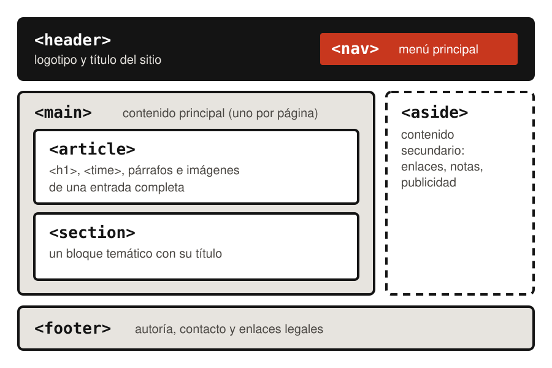

Cuando empecé a maquetar, todo era un `<div>`: el menú, la cabecera, cada tarjeta, el pie de página. Con suficiente CSS la página se veía bien, pero el código no decía nada sobre lo que contenía. El **HTML semántico** consiste en elegir la etiqueta que describe el *significado* del contenido, no su aspecto.

## El esqueleto de una página

HTML5 añadió un grupo de etiquetas pensadas para las regiones que casi todas las webs comparten:

| Etiqueta | Para qué sirve |
| --- | --- |
| `<header>` | Cabecera de la página o de una sección: logotipo, título, buscador. |
| `<nav>` | Un bloque de enlaces de navegación importante, como el menú principal. |
| `<main>` | El contenido principal. Solo debe haber uno visible por página. |
| `<article>` | Contenido con sentido propio, que se podría publicar por separado: una entrada, una noticia, un comentario. |
| `<section>` | Una parte temática de un documento, normalmente con su propio título. |
| `<aside>` | Información relacionada pero secundaria: una barra lateral, una nota. |
| `<footer>` | Pie de la página o de una sección: autoría, enlaces legales. |



## Antes y después

Este fragmento funciona, pero no comunica nada:

```html
<div class="cabecera">
  <div class="menu">
    <div><a href="/">Inicio</a></div>
  </div>
</div>
<div class="contenido">
  <div class="entrada">
    <div class="titulo">Mi primera entrada</div>
  </div>
</div>
```

Y este es el mismo contenido con etiquetas semánticas:

```html
<header>
  <nav aria-label="Principal">
    <ul><li><a href="/">Inicio</a></li></ul>
  </nav>
</header>
<main>
  <article>
    <h1>Mi primera entrada</h1>
    <time datetime="2026-10-28">28 de octubre de 2026</time>
  </article>
</main>
```

Es casi igual de largo, pero ahora el navegador sabe dónde está el menú, cuál es el contenido principal y qué texto es el título.

## Por qué importa

**Accesibilidad.** Los lectores de pantalla crean un mapa de la página a partir de estas etiquetas. Una persona ciega puede saltar directamente al `<main>` o listar todos los encabezados para hacerse una idea de la estructura, igual que nosotros echamos un vistazo rápido.

**Buscadores.** Google y compañía entienden mejor qué parte de la página es el contenido importante y cuál es el menú repetido en todas las páginas.

**Mantenimiento.** Dentro de seis meses, `</article>` se lee mucho mejor que el quinto `</div>` seguido.

## Tres reglas que sigo en este blog

1. **Un solo `<h1>` por página** y los niveles de título en orden, sin saltar de `<h2>` a `<h4>`.
2. **Botones para acciones y enlaces para ir a otro sitio.** Un `<div>` con un `onclick` no se puede usar con el teclado.
3. **Texto alternativo en las imágenes**: el atributo `alt` describe lo que muestra la imagen, o se deja vacío (`alt=""`) si es puramente decorativa.

Cualquier página de este blog sigue esa estructura; si abres las herramientas de desarrollo del navegador (F12) verás el `<header>`, el `<nav>`, el `<main>` y un `<article>` por entrada.
